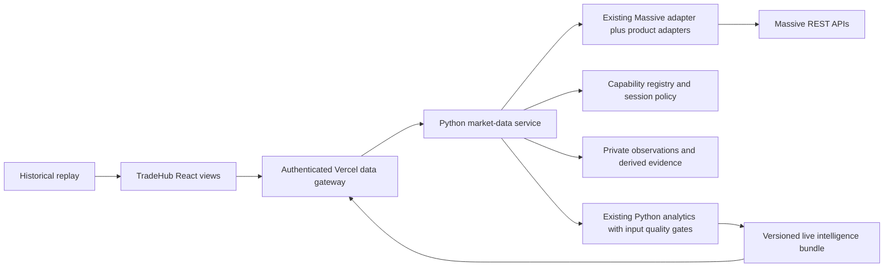

# Milestone 2: reliable Massive market data

Author: TradeHub engineering with EGM. Date: 2026-10-25. Status: independently reviewed draft, awaiting user approval. **Implementation is not authorized by this document.** See the [review findings and resolutions](./EGM-REVIEW.md).

The [first-increment addendum](./M2-0-M2-1-IMPLEMENTATION-ADDENDUM.md) resolves independent review findings and is normative where it refines the overview: exact first-phase routes, service auth, sessions/timestamps, account-wide budget coexistence, consumer ownership and acceptance measurement. Later phases still require their own detailed implementation review before activation.

## Overview and problem

TradeHub has useful live tools and a separate historical Market Intelligence workspace, but they do not share one trustworthy data contract. Some live prices lose ticker/time identity, historical bars can enter current analysis, and report refresh still retrieves a fixed Friday sample. Options are disabled by old code assumptions even though the connected account returned option evidence. VIX and futures pricing cannot be promised from the observed account access.

This milestone creates one server-owned data layer, reuses the existing Python Massive adapter and analytics, and gives every screen the same instrument identity, source time, delay, coverage and error rules. The first useful release is reliable QQQ/SPY/IWM market context, followed by options evidence and conditional index/futures context. It is a trading-intelligence system, not an order-entry or validated trade-signal system.

## Baseline, evidence and dependencies

Read the [inventory and entitlement ledger](./INVENTORY-AND-ENTITLEMENTS.md), [root architecture](../../EGM.md), [drift report](../../EGM-DRIFT-REPORT.md), and [security specification](../security/SECURITY-REMEDIATION-SPEC.md) together. They distinguish existing behavior from proposed changes.

- The connected account returned stock snapshots for QQQ, SPY, IWM and sampled options-chain rows for all three; sampled QQQ historical option quotes were accessible. Field availability and pagination remain scoped to those requests.
- I:VIX snapshot/daily requests and NQ/ES futures snapshots were explicitly NOT_ENTITLED. Futures reference access succeeded, but dated current-contract resolution and historical futures pricing remain unverified. EMPTY is inconclusive.
- Options Standard is user-reported. Exact plan name, deployment-account match, quota and exchange agreements are unresolved. The public [options page](https://massive.com/pricing?product=options) uses different individual-plan names; no guessed mapping is permitted.
- Sunday stock/options observations cannot prove an updating open-session feed. A provider REAL-TIME label does not make a Friday quote current.
- Security remediation has passed its implementation prerequisite: 145 tests and the browser build before M2 work; see [evidence](../security/IMPLEMENTATION-REPORT.md). New data routes cannot be released until operator authorization, path restrictions and notification protection are implemented and reviewed. This milestone must not expand the existing unguarded generic proxy.

## Goals

1. Show QQQ, SPY and IWM from the same named Massive deployment profile with verified symbol/time identity and understandable quality badges.
2. Show only licensed, observed options fields and expiration coverage. Replace claims that options access is absent with an evidence-based capability state.
3. Represent VIX, NQ and ES explicitly as available, delayed, unavailable or not entitled. No silent replacement with ETFs, broker data or another website.
4. Reject wrong symbols, future clocks, old callbacks, incomplete required history and mixed report identities before they can appear as current intelligence.
5. Make local and hosted paths use the same schema and policy. Preserve the existing historical review as an explicitly separate mode.
6. Keep Massive credentials server-side in the new layer. Keep journals, paper positions, broker sessions and research ledgers intact.

## Non-goals

No implementation, deployment, subscription purchase, exchange-agreement change, credential rotation or real notification is performed during specification/review. The eventual milestone adds no orders, automatic entries, P&L claims, institutional-identity claims or asserted dealer inventory. It does not validate an existing equity strategy for futures. Tick-level streaming and options on futures require later approved work; ordinary OPRA option tickers must not be invented for NQ/ES.

## Critical user journeys

- **Open Market Intelligence:** an authenticated user sees QQQ/SPY/IWM with source date/time, current retrieval time, feed delay and complete/partial evidence. A failed VIX tile says Not entitled; it does not remove the stock rows or pretend VIX is neutral.
- **Change ticker while loading:** selecting SPY invalidates the previous QQQ request generation. A late QQQ response is discarded, and loading SPY does not display QQQ's price under the SPY label.
- **View options:** the user selects QQQ and an actually observed expiration. All fetched strike sides in the declared window are shown; missing quote/Greek/OI stays missing. Incomplete pagination is conspicuous and blocks concentration conclusions that require a complete window.
- **Lose the feed:** prices remain visible only as last-known observations with their original source times. New current-session conclusions/alerts are blocked; a successful re-fetch must pass identity, freshness and coverage checks before recovery.
- **Open outside market hours:** Friday evidence is labeled with Friday's actual session, not Live and not “today.” NQ/ES use their own exchange session, which can be open Sunday evening when ETFs are closed.

## Proposed architecture

**Ownership:** extend the sibling `trade-decision-engine` server and `app/market_data/massive.py`; do not reimplement option/indicator calculations in React. New data-only service endpoints are separate from frozen strategy decisions. TradeHub's Vercel gateway checks operator access before every response, including cache hits, and makes authenticated server-to-server reads from the Python service. Browser requests never carry an arbitrary upstream path or Massive credential.

The new Python data routes require a dedicated service credential, exact accepted audience and deployment profile, quotas and private/no-store responses. Only the Vercel gateway receives that credential; it is distinct from the provider key. TLS is mandatory between hosted services. Host-only private routing without authentication is insufficient. Existing Python endpoints are not assumed secure merely because they exist.

**Transport choice:** use bounded server REST polling first. It fits the existing Python runtime and avoids persistent sockets in Vercel functions. Browser-visible context is a ten-second target cadence for the three ETFs; completed-minute history refreshes once a minute, selected options windows at most once a minute. These are targets subject to measured account quotas and request duration, never guarantees. One central per-profile scheduler/request coordinator coalesces identical in-flight reads and prevents overlapping refreshes. Initial implementation supports one service process; horizontal replicas must use a shared request lease before enabling multiple polling owners. New traffic cannot multiply simply because tabs/screens increase.

A later server streaming collector can implement the same envelope after product access, connection limits, hosting and gap recovery are independently reviewed. Do not extend direct browser key delivery as the new architecture. Preserve legacy live tools until their consumers migrate; retire ws-auth only after a tested replacement provides their required quotes. Until then, the authenticated-browser credential risk from the security specification remains.

## Instruments and conditional coverage

| UI instrument | Canonical identity and provider binding | Initial release behavior |
| --- | --- | --- |
| QQQ/SPY/IWM | ETF identity plus exact Massive ticker | First supported context set, contingent on deployment-key probes |
| VIX | Index identity bound to I:VIX | NOT_ENTITLED based on observed connector; do not treat as a stock or VIX futures |
| NQ/ES | Futures product root plus separately resolved dated contract ID | Reference-only/unavailable until actual market-data rights and current contract resolve are verified |
| ETF options | Full O: ticker, underlying, expiration, right, strike, multiplier and deliverable identity | QQQ/SPY/IWM selected windows; capabilities checked per field |
| VIX options | Separately discovered index-option contracts | Conditional later scope; options rights do not imply entitlement to the underlying index value |
| NQ/ES options | Separate futures-option product and adapter | Not supported by this milestone without verified product coverage and another specification |

Provider-returned contract identity wins over a guessed ticker format. Underlying and option IDs cannot be substituted across symbols, expirations, adjusted deliverables or multipliers. VIX has index value, not stock trade volume; its unavailable volume remains null.

For futures, enumerate dated active single contracts for the relevant session, then select the nearest valid expiry with at least five exchange trading sessions remaining. If that eligible set is empty, display resolution unavailable; do not revert to the expiring contract. This is a deterministic context roll policy, not a claim about the most-liquid contract. Show the actual contract and roll time. Compare history within one contract; reset session levels at roll. No back-adjusted continuous series or cross-contract price jump is used for signals. Verify exchange calendar, currency, tick size and multiplier before enabling futures-derived calculations. The existing nearest-maturity probe is reusable reference work, not accepted unchanged as the roll policy.

## Capability registry and entitlement verification

Capability key = deployment profile + asset class + endpoint family + instrument scope + field group + recency class. States are UNKNOWN, OBSERVED_AVAILABLE, NOT_ENTITLED and TEMPORARILY_UNVERIFIED. Record checked_at, request window, observed fields, provider timeframe, known quota, evidence source and expiry. Do not expose credentials, account IDs or key fingerprints in UI/diagnostics.

Connector evidence is a separate profile from local/staging/production evidence. Cache an explicit provider denial for at most 15 minutes per capability, with an operator-triggered recheck; one denial must not disable all market requests. HTTP 401/403 from TradeHub authentication is never a provider entitlement result. Provider HTTP 400 is a request problem; EMPTY may be valid sparse data, an invalid selection or an unavailable interval, and must not be converted to a plan denial. A changed configuration/profile invalidates old capability evidence. Positive observations expire after 24 hours for admission and must still pass current per-request quality checks.

Before enabling live claims, use the actual deployment profile during the product's open session: two bounded observations must show advancing source time, expected identity, applicable provider timeframe and acceptable age. A named subscription or a single recent-looking timestamp is insufficient. Documentation assists request construction, not proof of purchase.

No quota is inferred from a paid-plan nickname. Start the coordinator with a conservative five provider calls/minute when actual limits are unknown; show limited refresh and block live claims if that cannot meet freshness. After names-only account verification, set an approved per-profile budget, initially capped at 120 calls/minute. Reserve no more than four concurrent upstream requests; leave capacity for active-ticker refresh ahead of background history. An approximate three-ETF workload is 18 quote requests plus three minute refreshes/minute before selected options/history pagination; measure actual calls and latency rather than hiding pagination cost. Circuit breakers are scoped per endpoint/product and never promote stale data.

## Unified data envelope

Create `market-data-envelope-v1` for observations and `live-intelligence-v1` for immutable analytic bundles. Do not loosen the existing sample-only transport schema or relabel archived reports as live.

Every response includes these semantics, validated server-side and at the browser boundary:

| Field group | Required meaning |
| --- | --- |
| Identity | schema_version, deployment_profile, canonical_instrument_id, provider_symbol, asset_class, selected_contract_id when applicable, requested/returned identity verification |
| Origin | provider=Massive, endpoint_family, transport=REST, feed_timeframe REAL_TIME/DELAYED/EOD/UNKNOWN, declared_delay_seconds when known, price_kind TRADE/QUOTE_MIDPOINT/INDEX_VALUE/BAR_CLOSE |
| Time | provider_observed_at per field, ingested_at, retrieved_at, session_id/date, bar_start/bar_end/completed when applicable; all canonical UTC |
| Quality | availability, freshness, coverage, age_seconds, missing_fields, invalid_fields, reason_codes and policy_version; these are independent dimensions |
| Coverage | requested versus returned window/expiration/strike range, pages read, pagination_complete, bars/contracts observed and expected minimums |
| Value | nullable typed numbers/quotes/bars with currency/units; null is unavailable and zero is retained when valid |
| Analysis | bundle_id, generated_at, input observation IDs, input policy version, component as-of times and quality; analytic output is never its own source observation |

Snapshot fields have different times: a quote, last trade, daily OI and Greek calculation must not inherit the snapshot's newest timestamp. Preserve raw timestamp as a decimal string where needed and convert using endpoint-documented units, not a guessed magnitude. Stock/options aggregate t is milliseconds; documented snapshot/quote/trade/futures event fields use their own nanosecond rules. Python integers own conversion; JavaScript must not round nanoseconds through an unsafe integer. Unknown timestamp/units are non-current. Future source time beyond five seconds is INVALID_CLOCK; negative age is never clamped into live status.

## Freshness, sessions and action safeguards

All limits below are proposed product policies, not Massive latency guarantees. Freshness is recalculated at response and display time, including cache hits; retrieval time never resets source age. Browser display ages against server time plus elapsed monotonic time, and rechecks when visibility resumes.

| Data | Current-context requirement during its verified open session |
| --- | --- |
| ETF stock quote/trade observation | Real-time or verified non-delayed profile; age <=30 seconds |
| Selected option bid/ask | Real-time field; both prices valid, quote age <=30 seconds and underlying timestamp skew <=5 seconds |
| VIX index value, if later entitled | Age <=60 seconds and appropriate index calculation session |
| Futures observation, if later entitled | Age <=30 seconds, dated contract verified and exchange session open |
| Completed 1-minute bar | bar_end<=now; newest completed bar end no more than 90 seconds old, no missing required intervals |
| Daily/weekly structure | Last required completed session/week, adequate lookback and explicit adjustment policy; never labeled tick-current |
| OI | Latest provider daily value with observation and effective/as-of date if supplied; never inferred to change intraday |

Availability = AVAILABLE, UNAVAILABLE, NOT_ENTITLED, ERROR. Freshness = CURRENT, DELAYED, STALE, LAST_CLOSED_SESSION, UNKNOWN, INVALID_CLOCK. Coverage = COMPLETE, PARTIAL, UNKNOWN. A delayed feed remains DELAYED even when retrieved just now; if declared delay is known, source age beyond delay plus 60 seconds becomes STALE. Unknown delay never becomes real-time by observing small age alone. During closure, LAST_CLOSED_SESSION applies only when the observation matches the last expected session and can be identified; older evidence remains STALE. Unknown schedule gives UNKNOWN freshness and a blocked current-context gate.

Use product-specific maintained schedules: ETF exchange calendar including early closes; per-contract option sessions; index publication sessions; futures maintenance and exchange session_end_date. Persist UTC but show CT/ET explicitly. Do not reuse the equity 09:30–16:00 rule for futures or assume every option closes at 16:00. The existing Python calendar/freshness helpers are a starting point; their 90/300-second and future-time clamping behavior is not the new multi-product policy.

Market data being CURRENT is necessary, not sufficient, for any trade readiness. Milestone 2 publishes evidence with trade_readiness=NOT_EVALUATED; it creates no new trade instruction or live alert. During migration, existing coach/setup consumers must require matching instrument/session, complete required history and CURRENT inputs before new actionable transitions. Historical context stays visible but cannot satisfy those gates. An absent VIX/futures dependency cannot be filled with another instrument or silently count as cross-market confirmation. Each analytic component declares its required inputs; only components with satisfied dependencies may publish conclusions.

## Incorrect-ticker, cache and history safeguards

- Bind every async response to canonical instrument, account profile, parameters, request generation and session epoch. Abort obsolete work and independently reject late callbacks after ticker switch/logout. Purge client market caches on session changes; prevent old responses from repopulating them. Do not relabel an old scalar price under the new ticker while loading.
- Cache keys include profile, instrument/contract, endpoint family, expiration/window, timeframe, adjustment and policy version. Mutable quote TTL at most five seconds; negative capability evidence has its separate 15-minute bound. Authenticate before serving any cache hit. Private history may be cached longer only for completed immutable intervals; correction/adjustment policy is versioned.
- Verify response identity against request binding and available provider identity. Missing/unverifiable identity is flagged and cannot drive current conclusions. Validate positive finite prices, bid<=ask, coherent OHLC, unique chronological bars, matching currency/multiplier/deliverable and no post-cutoff inputs.
- Retrieve sufficient trading sessions, not a fixed number of calendar days. A 200-day EMA requires 200 observations; 52-week range requires the declared full completed trading-year window. No short slice may use those names. Paginate until the declared range completes; a full page without a defensible end or a loop is PARTIAL/error. Reconcile gaps before current status.

## Options positioning and data limitations

Discover actual expirations from reference data before querying chains. Start with one user-selected expiration per ETF and a declared +/-15% underlying strike window; fetch up to 250 contracts/page and a maximum 10 pages/30 seconds per refresh. If the cap/time limit is reached, publish PARTIAL with its window and cursor state, never “full chain.” Cursor URLs remain server-side, same fixed provider origin/path family, stripped of credential parameters and loop-checked. Do not accept arbitrary next_url from the browser.

Show each observed strike and missing side distinctly. Derive expiration-specific OI from actual contracts, not a split of multi-expiration totals. Store a dated daily OI observation only when data rights allow it; create append-only observation identity rather than replacing same-day source rows. Comparison requires same contract/deliverable, known comparable OI dates and disclosed elapsed sessions. First snapshot, absent contracts, uncertain OI effective date and same-day retrieval cannot establish a daily change. Never claim historical OI that the provider did not supply or we did not store.

Greeks/IV/quotes/trades may be absent by plan or contract. Presence in one sampled row does not guarantee whole-chain coverage. Quote-derived expected moves require valid timestamped bid/ask pairs from the same expiration and coherent underlying reference; otherwise unavailable. Unusual-volume findings require an actual comparable baseline for that contract and session-normalized volume. Sampled prints do not establish whole-market flow, aggressor identity, opening/closing intent or institutional activity. Gamma inventory signs remain explicit assumptions, not measured dealer holdings.

VIX options, if added later, require explicit contract and settlement metadata and an independently available underlying reference. Futures options are not enabled through an O: string shortcut. Do not replace live chain evidence with Wheel's modeled premiums; keep Model estimate and Observed quote separate in the UI.

## Live intelligence publication and source attribution

Existing Python analytics remain the single calculation owner. Introduce a live context orchestration path which consumes validated observations, completed bars and disclosed options coverage; do not simply call the preparation report builder with today's date during the session. The current builder intentionally enforces a pre-session cutoff. Keep that replay/preparation behavior unchanged.

Publish an immutable bundle only after component dependency checks. Each component keeps its own as-of time; a single maximum cutoff cannot make every input current. Require matching profile, instrument/contract, report session, input bundle IDs and policy versions across maps, options and analyst presentation. Expired components can remain labeled context but are excluded from current conclusions. AI summaries, if later enabled, receive only this validated bundle and must cite its evidence; they cannot fetch missing data or invent it. No new AI integration is part of this milestone.

Persist only private, permitted derived evidence and metadata. Initial retention proposal is 30 days of live bundles/quality logs and 400 trading sessions of derived daily OI comparisons, **only after account/data-rights confirmation**; otherwise persistence is disabled and OI comparisons remain unavailable. No raw licensed samples in Git, static bundles or public Pages. Storage failures surface as errors and cannot produce a successfully published new bundle. Current SQLite artifacts are preserved; hosted durable storage uses the Python service's existing database abstraction rather than Vercel function-local files.

## Error behavior and observability

The gateway exposes typed resources, proposed `GET /api/market/{capabilities|snapshot|bars|options|intelligence}`. Requests select supported canonical instruments/windows, not raw provider URLs. Internal Python routes are under `/api/v1/market-data/`; the historical `/api/v1/market-intelligence/` remains separate. Types share the versioned envelope; upstream auth/configuration failures are sanitized.

| Condition | Required handling |
| --- | --- |
| Operator unauthenticated / wrong operator | 401/403; unmount consumers, no provider probe |
| Provider/service key absent or service/store unavailable | 503 CONFIGURATION/DEPENDENCY_UNAVAILABLE; no fabricated empty success |
| Provider explicit denial | Capability NOT_ENTITLED scoped to requested product/fields; other instruments remain readable |
| Invalid instrument/parameters | 400 with bounded public reason, no raw upstream URL or key |
| Provider 429 | Respect Retry-After and shared budget; bounded backoff with jitter; preserve last-known time and non-current state |
| Timeout/5xx/invalid JSON | 502/504 sanitized; no blind overlapping refresh; last-known data is separate from failed attempt |
| Valid request but zero observations | AVAILABLE+empty coverage where verifiably valid, otherwise UNAVAILABLE/UNKNOWN with selection details; never automatically NOT_ENTITLED |
| Wrong symbol, future clock, malformed values, cyclic pagination | Reject affected component; preserve other valid components with explicit partial report |

Individual bounded fetch timeout 10 seconds, at most one retry for idempotent reads on 429/eligible 5xx within the 30-second refresh deadline. No retry for bad input, operator auth or explicit entitlement denial. While refreshing, previously current observations continue to age; the badge must expire even if no new request completes.

Log profile, canonical instrument, endpoint family, public error class, duration, observation age, pages/gaps and refresh outcome. Never log auth headers, cookies, provider/service keys or cursor URLs. Metrics distinguish successful fetch from fresh observation, and fetched report from published complete component. Include application and policy revisions in protected diagnostics.

## Local versus production

Local live development uses the same typed Vercel gateway handlers via the existing working-tree Vite middleware and a loopback Python data service. Required configuration is names-only: operator login settings; MARKET_DATA_SERVICE_URL plus service credential; Python MASSIVE_API_KEY. Legacy TradeHub POLYGON_API_KEY remains only until old REST/WS consumers migrate. No browser VITE_ variable carries secrets.

Hosted Vercel uses an explicitly configured authenticated Python-service URL and durable server-side state. It does not execute Python inside the static Vite bundle or read another repository's local SQLite path. No service deployment, new database or secret is provisioned by this specification. Availability/cost of the chosen existing Python host and access controls must be verified before hosted approval. Historical preview on port 4180 stays independent and clearly disables live market services. No report fixture is injected into the live service.

## Alternatives considered

- **Keep independent browser fetches and pass a key to each screen:** small initial diff, but retains exposed credentials, inconsistent timestamps and duplicate traffic; rejected as the unified layer.
- **Rebuild analytics in JavaScript/Vercel:** simpler single repository but duplicates the existing Python options engine and invites inconsistent calculations; rejected.
- **Use the existing preparation report as live:** reuses schemas/files but violates its cutoff and sample-only semantics; rejected.
- **Stream every asset immediately:** good for future tick-level needs, but adds a persistent collector before rights, budgets and correctness are verified; defer behind the same contract.
- **Use broker/ETF proxies for denied symbols:** may look complete, but changes source/instrument meaning and access requirements; rejected as silent substitution. Any future alternative source needs explicit attribution and another approved adapter.

## Detailed Implementation Plan

M2.0 and M2.1 have completed focused EGM review and received explicit user implementation approval. Later increments still require focused review and approval; deployment is a separate approval.

### M2.0: security prerequisite and exact capability evidence

Finish the separately reviewed security increment. Establish the intended account profile and Options Standard meaning, validate actual server-side capabilities without printing secrets, and publish a protected capabilities panel. Acceptance: stock/options capabilities are evidence-backed; VIX/NQ/ES show truthful denied/unknown states; one denial never blocks other endpoints; no anonymous provider/key access. This is the first implementation milestone to approve, not a multi-asset UI expansion.

### M2.1: QQQ/SPY/IWM quality contract and shared context

Add envelope validators, instrument registry, server coordinator, identity/session epochs, exact timestamp handling and product sessions. Bind the three ETFs to the typed gateway. Acceptance: stale/wrong-ticker/future observations cannot appear current; source times advance in an open-session verification; cache hits do not renew age; logout/late responses cannot cross sessions; quotes and completed bars remain different fields.

### M2.2: history and live Market Map

Repair lookback/pagination and build a new live bundle from completed bars and the validated three-ETF context. Migrate Market Map in an explicit Live context mode while preserving historical replay. Acceptance: 52-week/EMA coverage is demonstrated or unavailable; failed refresh cannot mark neutral data fresh; maps retain per-component timestamps and dependency reasons. No change to frozen strategy rules or prediction claims.

### M2.3: subscription-aware options evidence

Implement reference discovery and bounded per-expiration chains for the three ETFs, per-field timestamp/entitlement states and permitted daily OI persistence. Replace the hardcoded options-unavailable UI only after deployment-key proof. Acceptance: missing sides/fields stay distinct from zero, partial pagination is visible, no stale bid/ask passes current-context tests, and no daily OI delta or unusual-flow claim appears without comparable evidence.

### M2.4: conditional VIX and futures context

Implement index and dated futures adapters only if rights are verified; otherwise ship capability-aware unavailable tiles. Resolve current contracts with verified calendars/roll policy before pricing. Acceptance: independent session dates, no root-ticker aggregate shortcut, visible contract rolls and no proxy substitution. Additional subscription costs are an explicit user choice, never an automatic action.

### M2.5: controlled environment verification

Test local, closed-market and approved protected staging environments with the same contract. Measure real provider age, effective cadence, page coverage, error recovery and budget. Acceptance: successful sustained three-ETF session run under configured limits, options behavior verified under actual rights, no secrets in browser assets/logs and fail-closed readiness on missing/late data. Obtain separate approval before deployment or production settings changes.

### Proposed file scope

| Repository | Files to modify/create in later approved implementation | Purpose |
| --- | --- | --- |
| TradeHub | new `contracts/market-data-envelope-v1.schema.json`, `contracts/live-intelligence-v1.schema.json`; new `api/market/[resource].js`, `api/_lib/marketDataGateway.js` | Typed authenticated server boundary; service credential remains server-side |
| TradeHub | new `src/lib/marketDataContract.js`, `src/hooks/useMarketData.js`; modify `src/App.jsx`, `src/hooks/useLiveData.js`, `useLiveDataMulti.js`, `src/lib/massive.js` | One client contract, observation identity, deduplicated subscription scope, gradual legacy migration |
| TradeHub | modify intelligence components, `Command.jsx`, `Levels.jsx`, `Chart.jsx`, `Calendar.jsx`, `tabs.jsx`, `WheelScanner.jsx`, `src/lib/sectors.js`, `src/hooks/useBot.js`, `src/lib/conditionEvaluators.js`, `src/lib/setupEngine.js` | Visible provenance/errors, capability-driven options, safeguards on existing consumers; no strategy-rule changes |
| TradeHub | modify `scripts/vite-api.mjs`, `README.md`, relevant EGM contracts; new `tests/market-data-contract.test.js`, `market-data-ui.test.jsx`, `market-data-routing.test.js` | Local parity, source attribution and regression coverage |
| Python engine | modify `app/market_data/base.py`, `massive.py`; new `app/market_data/capabilities.py`, `instruments.py`, `quality.py`, `sessions.py`, `budget.py`, `service.py`, `api.py` | Reuse provider implementation, add typed evidence and coordinator; new quality/session modules leave existing `app/freshness.py` decision defaults intact |
| Python engine | new `app/market_data/live_options_adapter.py` in M2.3 | Replace legacy relative-age/liquidity/pagination quality outputs with authoritative live envelope quality while reusing calculations |
| Python engine | modify `app/main.py`, `app/config.py`, relevant database migration/repository files after storage review; new `app/live_intelligence.py` | Register protected data routes, names-only configuration, append-only evidence and separate live publication |
| Python engine | new data/quality/capability/session/options/pagination/service-auth tests under existing `tests/`; update `REALTIME_DATA.md` and relevant contracts | Verify both existing behavior and new envelope; document different threshold policies explicitly |

Storage schema/migration filenames and final deployment topology require a focused implementation specification before M2.3/hosted rollout. They are not silently delegated decisions in the first M2.0/M2.1 change.

## Verification and measurable release checks

Use synthetic clocks/fixtures and mocked providers for wrong-symbol switching, session/logout races, timestamp units, future time, price validity, completed-bar boundaries, missing history, page loops, quota exhaustion, 401/403/429, malformed JSON and partial dependencies. Test each freshness threshold exactly at and one second beyond the boundary. Tests must assert no current conclusions/alerts from blocked inputs, not merely the presence of a warning label.

TradeHub's existing `npm test` and `npm run build` remain required. The Python engine's existing test configuration and database prerequisites must also pass for files changed there; add targeted adapter/gateway tests without contacting providers. Later, operator-authorized bounded verification through the actual server profile must run during the correct open sessions, then through approved staging. Offline tests and Sunday probes cannot satisfy that live verification.

For the three-ETF MVP, measure source-age distribution, fetch latency, freshness-qualified response percentage, failed/partial refreshes and provider calls/minute over a full session. Proposed target is >=99% CURRENT context during eligible open-session observation windows, excluding declared exchange halts but including provider outages as failures. Budget/entitlement constraints can make this unattainable; release must report measured results rather than weaken thresholds to pass. No multi-asset uptime or execution-latency promise is made.

## Open questions and approval boundary

1. Exact Options Standard account product and whether connector/deployment keys share that account; which quote/trade/history rights and usage limits apply.
2. Whether denied VIX/futures data should remain visibly unavailable or be enabled later through a separately approved subscription. No purchase is proposed as mandatory for the three-ETF MVP.
3. Which existing Python hosting/database environment will serve the protected gateway and its measured cost/latency; no account/cloud setting has been changed or inferred from a local checkout.
4. Data retention/display permissions and allowed evidence persistence. Until confirmed, persistent OI comparisons remain disabled.

These are explicit release dependencies. They do not prevent a reviewable conditional architecture or offline implementation plan, but they prevent claiming that all requested instruments are currently licensed or that the final multi-asset service is ready to deploy. User approval of the specification is required before any implementation begins.

*Drafted with EGM, using the existing architecture and read-only capability evidence.*
